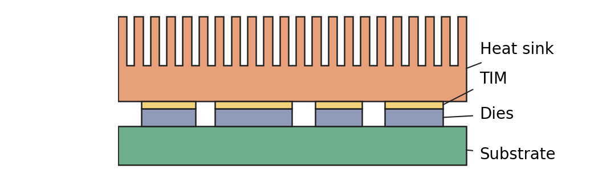
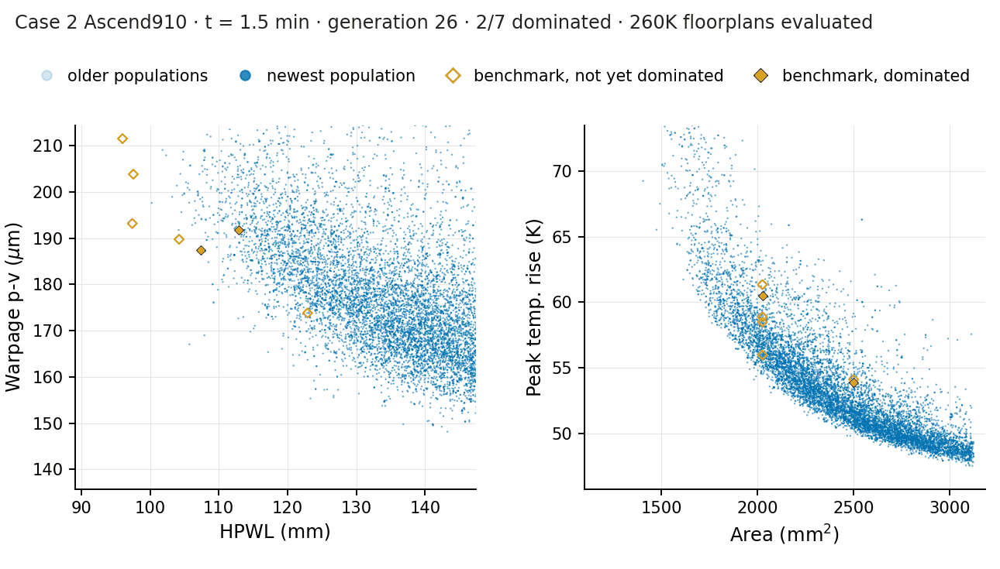
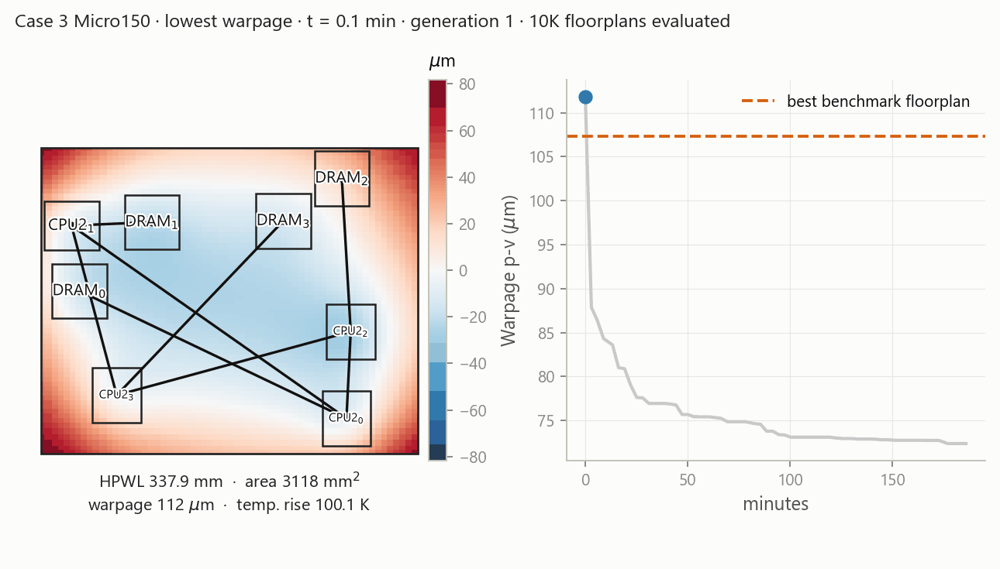
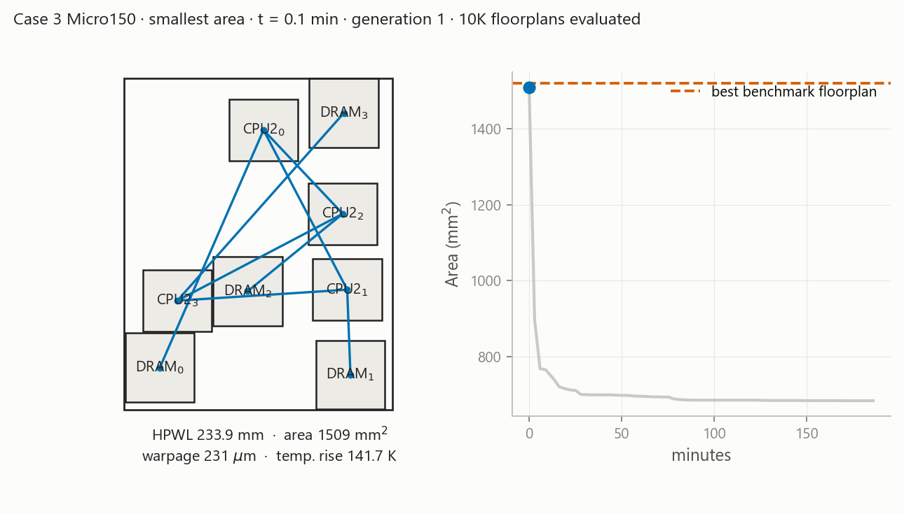
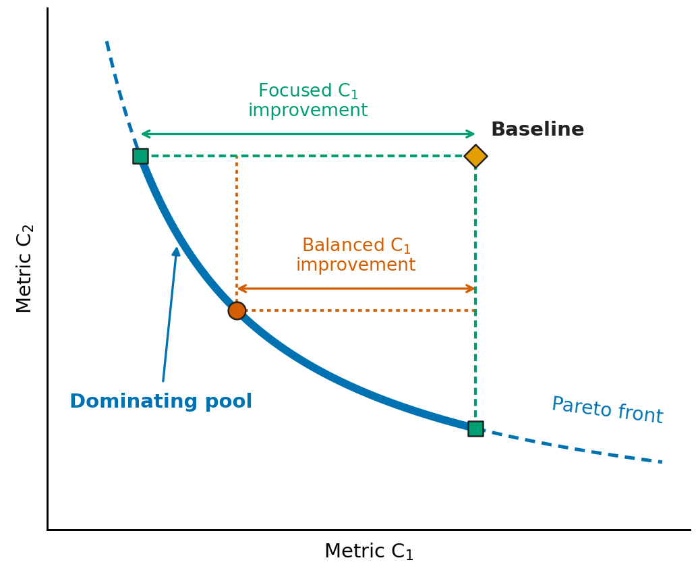
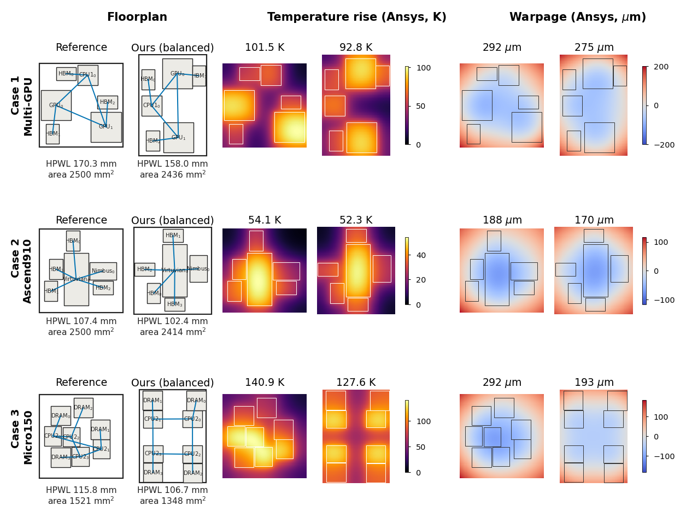
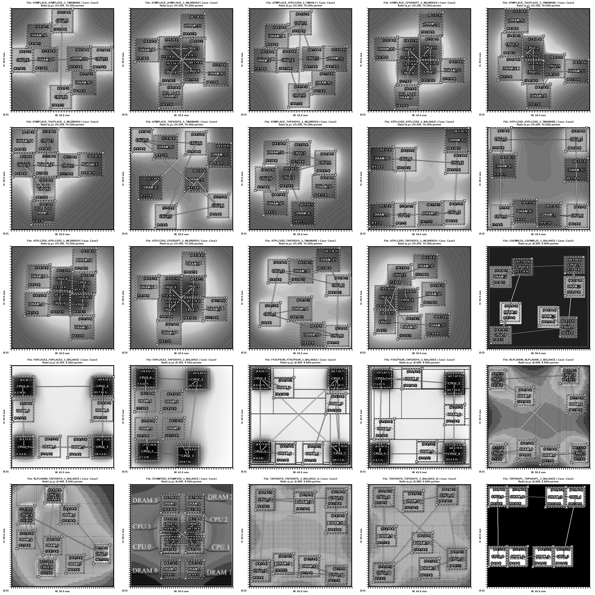

# Thermal and warpage aware chiplet floorplanning with an evolutionary optimizer

Companion material for the experiments section of the paper: animations of the optimizer runs, figures, and result tables.

  

One optimizer run. Blue points are the populations of all generations so far, with the opacity increasing with the generation. Orange diamonds are the baseline floorplans, hollow while they are not yet dominated and filled once they are. The title line gives the time, the generation, the number of dominated baseline floorplans, and the number of floorplans evaluated so far.

## Setup

Three systems of a chiplet-placement benchmark suite are used. The suite provides 42 baseline floorplans for them, generated by prior floorplanners under different objectives. All baseline floorplans are evaluated with the same surrogate model and the same die powers as ours.

Four objectives are minimized: wirelength, substrate area, warpage, and peak temperature rise. The substrate area of a baseline floorplan is the area of its given substrate, and that of our floorplans is the bounding box of the dies including whitespace around them on all sides. A floorplan dominates another if it is no worse in all four objectives and strictly better in at least one.

| case | system | dies | power | baseline floorplans | all dominated after | generations |
|---|---|---|---|---|---|---|
| 1 | Multi-GPU | 6 | 780 W | 10 | 5.6 min | 104 |
| 2 | Ascend910 | 6 | 370 W | 7 | 7.7 min | 137 |
| 3 | Micro150 | 8 | 680 W | 25 | 95 min | 1,614 |

## Surrogate model

Warpage and peak temperature are evaluated by a neural surrogate that takes the die rectangles on a substrate and the die powers. It evaluates a floorplan in about 0.3 ms, against about 72 s for an Ansys solve. The surrogate consists of two U-Nets of about one million parameters each. The first predicts the temperature in 16 nodal planes through the stack, and the second predicts the plate deflection from the die coverage, the heat source, and the layer temperatures. Both are trained without solver data by minimizing discretized thermal and plate energies. The package is a 1 mm FR-4 substrate, 0.15 mm silicon dies, a 10 µm indium TIM over the dies only, and a 2 mm copper heat sink base over the whole footprint, with the fins lumped into a heat transfer coefficient of 5000 W/m²K and an ambient temperature of 22 °C. The relative root-mean-square error with respect to Ansys is 3.4 % for warpage and 1.5 % for peak temperature rise.

## Optimization

The optimizer is NSGA-II on the GPU. A floorplan is encoded by a sequence pair, continuous whitespace around each die, and a rotation per die. The whitespace is mutated by a Gaussian step with a standard deviation of 0.03 mm applied to 10 % of the genes. The whole generation is executed as a single CUDA graph, so that, with a population of 10,000, one NVIDIA RTX 4070 evaluates about 2,850 floorplans per second.

Each run is continued until every baseline floorplan of the case is dominated by a feasible member of the population, and then for the same time again. Every feasible floorplan encountered during a run is stored and reduced to its non-dominated members, which form the archive.

A baseline is dominated after 4.9 minutes on average, or 84 generations. The slowest baseline, a wirelength-driven floorplan of ATPlace2.5D in Case 3, is dominated after 95 minutes. It has the lowest HPWL of the 25 baselines in the case, 74.7 mm against 69.3 mm for the best floorplan found, and only 33 of the 4,344 non-dominated floorplans that match its HPWL and area also match its warpage and peak temperature rise. The second slowest baseline, a TAP-2.5D floorplan in Case 2, is dominated after 7.7 minutes.

### Fronts over the generations

<table>
<tr>
<td></td>
<td></td>
</tr>
<tr>
<td colspan="2"></td>
</tr>
</table>

### Best floorplan of each objective over time

For each objective, the animation shows the best member of the population over time. For temperature and warpage the floorplan is drawn over the field.

<table>
<tr>
<td></td>
<td></td>
</tr>
<tr>
<td></td>
<td></td>
</tr>
</table>

## Floorplan selection

A multiobjective optimizer returns a full Pareto front, while each baseline is a single floorplan. We therefore compare each baseline with the set of floorplans that dominate it, the dominating pool. Every floorplan in the pool is no worse than the baseline in all metrics, so no improvement in one metric comes at the expense of another. The focused improvement in a metric is the largest relative improvement in that metric attained by any floorplan in the pool. The balanced improvement is the improvement of the single floorplan in the pool with the largest sum of improvements over all metrics.

For fair comparisons, we first only consider the optimized floorplans which confidently dominate each baseline. To account for the error of the surrogate relative to Ansys, we specifically consider only floorplans that dominate the baseline with one-sided 95 % confidence in warpage and in peak temperature rise. The relative root-mean-square error of the surrogate with respect to Ansys is 3.4 % for warpage and 1.5 % for peak temperature rise. For 6 of the 42 baseline floorplans, no floorplan satisfied the bound, and only the most confident dominating floorplan is considered for comparison, as both the focused and the balanced floorplan.

## Verification in Ansys

All baseline floorplans and all selected floorplans were evaluated in Ansys Mechanical APDL. Each solve is a three-dimensional thermal analysis followed by a thermo-elastic analysis of the package, using the same stack, die powers, and metric definitions as the surrogate. A solve takes about 72 s on four cores.

## Results

Improvement over the baseline floorplans, evaluated in Ansys and averaged over all 42 baselines. A minus sign denotes a reduction of the objective.

| | wirelength | area | warpage | peak temperature rise |
|---|---|---|---|---|
| Focused | -20.9 % | -13.5 % | -20.9 % | -14.1 % |
| Balanced | -14.8 % | -4.6 % | -15.3 % | -10.4 % |

In Ansys, the balanced floorplan dominates its baseline in all four objectives for all 42 baselines, and so does every other selected floorplan.

| case | wirelength | area | warpage | peak temperature rise |
|---|---|---|---|---|
| 1 | -6.2 % | -2.8 % | -5.8 % | -8.1 % |
| 2 | -3.6 % | -2.9 % | -8.6 % | -3.7 % |
| 3 | -21.4 % | -5.8 % | -20.9 % | -13.2 % |

The next figure compares one baseline floorplan per case with the balanced floorplan that dominates it, using the Ansys solutions.

The shift from each baseline floorplan to its balanced floorplan, for all 42 baselines:

## Baseline Dataset Distribution

| Extracted Baseline Sample Paper Title | Abbreviation |
| :--- | :--- |
| `ATMPlace_Analytical_Thermo-Mechanical-Aware_Placement_Framework_for_2.5D-IC` | `ATMPLACE` |
| `ATPlace2.5D_Analytical_Thermal-Aware_Chiplet_Placement_Framework_for_Large-Scale_2.5D-IC` | `ATPLC25D` |
| `Connectivity-Guided_Feasibility_Masking_for_Efficient_Chiplet_Placement_in_2.5D_Packaging_via_Reinforcement_Learning` | `CGFMRL25` |
| `FAPlace_Joint_Optimization_of_Chiplet_Placement_and_Interposer_Footprint_for_2.5D_Systems` | `FAPLACE2` |
| `Chiplet_Placement_for_2.5D_IC_with_Sequence_Pair_Based_Tree_and_Thermal_Consideration`	| `CP25DSPT` |
| `Fast_Thermal-Aware_Chiplet_Placement_Assisted_by_Surrogate` | `FTACPSUR` |
| `RLplanner_Reinforcement_Learning_based_Floorplanning_for_Chiplets_with_Fast_Thermal_Analysis` | `RLPLANNR` |
| `STAMP-2.5D_Structural_and_Thermal_Aware_Methodology_for_Placement_in_2.5D_Integration` | `STAMP25D` |
| `TACPlace_Ultrafast_Thermal-Aware_Chiplet_Placement_with_Feasibility_Seeking` | `TACPLACE` |
| `TAP-2.5D_A_Thermally-Aware_Chiplet_Placement_Methodology_for_2.5D_Systems` | `TAP25DYS` |
| `TDPNavigator-Placer_Thermal-_and_Wirelength-Aware_Chiplet_Placement_in_2.5D_Systems_Through_Multi-Agent_Reinforcement_Learning` | `TDPNAVPL` |

### Dataset Analytics

#### Method Representation

Breakdown of placement methods represented across the 42 baseline benchmark samples:

* **TAP25DYS**: 17 samples (40.5%)
* **ATPLC25D**: 4 samples (9.5%)
* **CP25DSPT / FTACPSUR / RLPLANNR / STAMP25D**: 3 samples each (7.1% each)
* **ATMPLACE / CGFMRL25 / TACPLACE / TDPNAVPL**: 2 samples each (4.8% each)
* **FAPLACE2**: 1 sample (2.4%)

#### Case Representation

Distribution of benchmark test cases across the dataset:

* **Case 3 (Micro150)**: 25 samples (59.5%)
* **Case 1 (Multi-GPU)**: 10 samples (23.8%)
* **Case 2 (Huawei Ascend 910)**: 7 samples (16.7%)

#### Method and Case Combination

Grouped breakdown showing baseline representation of each case across each method **Case 1**, **Case 2**, and **Case 3**.
### Benchmark Case Topologies

| Case 1 - Multi-GPU | Case 2 - Ascend 910 | Case 3 - Micro150 |
| :---: | :---: | :---: |
|  |  |  |

* **Case 1 (Multi-GPU)**: Uses a 6-chiplet topology featuring 1 CPU (CPU1_0, 12 x 12 mm, 105 W), 2 GPUs (GPU_0 & GPU_1, 18 x 18 mm, 300 W each), and 3 HBM stacks (HBM_0–HBM_2, 8 x 12 mm, 25 W each).
* **Case 2 (Huawei Ascend 910)**: Has a 6-chiplet topology centered around a central compute die (Virtuvian_0, 31.4 x 14.5 mm, 256 W) connected to 1 I/O die (Nimbus_0, 10.5 x 16 mm, 14 W) and 4 HBM stacks (HBM_0–HBM_3, 8 x 12 mm, 25 W each).
* **Case 3 (Micro150)**: (Also known as CPU-DRAM) features an 8-chiplet mesh topology consisting of a 2 x 2 CPU array (CPU2_0–CPU2_3, 8 x 9 mm, 150 W each) paired with 4 DRAM chiplets (DRAM_0–DRAM_3, 9 x 9 mm, 20 W each).

### Manual Benchmark Extraction & Digitization Methodology

Because raw placement coordinates are rarely distributed alongside published 2.5D IC placement results, all 42 baseline floorplans were manually extracted by hand from the floorplan and thermal-map figures in their respective publications.

#### Digitization Workflow
1. **Figure Cropping & Interposer Calibration**: Each published floorplan image was cropped tightly to the interposer boundary setting the bottom-left corner as the `(0, 0)` origin, and mapped to its reported physical interposer dimensions to compute exact pixel-to-millimeter conversion ratios (`px/mm`).
2. **Chiplet Bounding Box Annotation**: Using each chiplet's known physical footprint from the benchmark specification (`Case1`, `Case2`, `Case3`), the bottom-left `(x_min, y_min)` and top-right `(x_max, y_max)` coordinates of every die were manually aligned and recorded over the source figure.
3. **Adjacency & Orientation Verification**: Chiplet identities, rotations, topology, and connectivity were cross-checked against each benchmark's adjacency graph to ensure accurate die labeling.
4. **Visual Overlay Validation**: Every digitized placement was rendered on top of its grayscaled original source figure with dashed bounding boxes, corner coordinate callouts, and interconnect lines to verify sub-millimeter visual alignment across all three benchmark cases.

### Extraction Validation Overlays

#### Case 1 Overlays (Multi-GPU - 10 floorplans)
  
#### Case 2 Overlays (Huawei Ascend 910 - 7 floorplans):
  
#### Case 3 Overlays (Micro150 - 25 floorplans)
  
#### Case 11 Overlay and Floorplan
  
