# Thermal and warpage aware chiplet floorplanning with an evolutionary optimizer

Companion material for the experiments section of the paper: animations of the optimizer runs, figures, and result tables.

  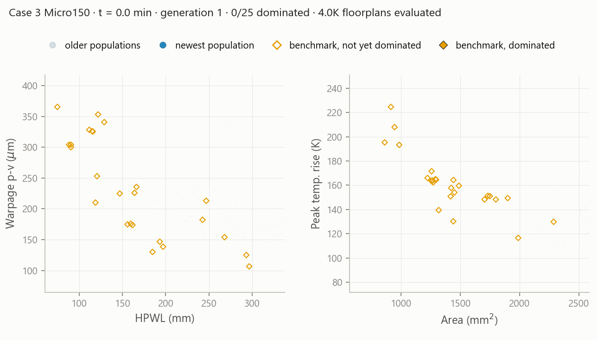

One optimizer run. Blue points are the populations of all generations so far, with the opacity increasing with the generation. Orange diamonds are the reference floorplans, hollow while they are not yet dominated and filled once they are. The title line gives the time, the generation, the number of dominated reference floorplans, and the number of floorplans evaluated so far.

## Setup

Four systems of a chiplet-placement benchmark suite are used. The suite provides 43 reference floorplans for them, generated by prior floorplanners under different objectives or, for Case 11, taken from the actual product. All reference floorplans are evaluated with the same surrogate model and the same die powers as ours.

Four objectives are minimized: wirelength, substrate area, warpage, and peak temperature rise. A floorplan dominates another if it is no worse in all four objectives and strictly better in at least one.

| case | system | dies | power | reference floorplans | all dominated after | generations |
|---|---|---|---|---|---|---|
| 1 | Multi-GPU | 6 | 780 W | 10 | 639 s | 505 |
| 2 | Ascend910 | 6 | 370 W | 7 | 308 s | 254 |
| 3 | Micro150 | 8 | 680 W | 25 | 588 s | 471 |
| 11 | EPYC Genoa | 13 | 400 W | 1 | 75 s | 61 |

## Optimization

The optimizer is NSGA-II on the GPU. A floorplan is encoded by a sequence pair, continuous margins around each die, and a rotation per die. The whole generation is executed as a single CUDA graph, so that, with a population of 4000, one NVIDIA RTX 4070 evaluates about 3,200 floorplans per second.

Each run is continued until every reference floorplan of the case is dominated by a feasible member of the population, and then for the same time again. Every feasible floorplan encountered during a run is stored and reduced to its non-dominated members, which form the archive.

### Fronts over the generations

<table>
<tr>
<td>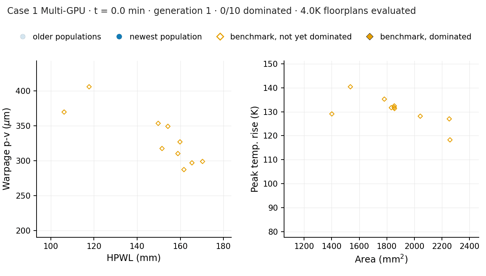</td>
<td>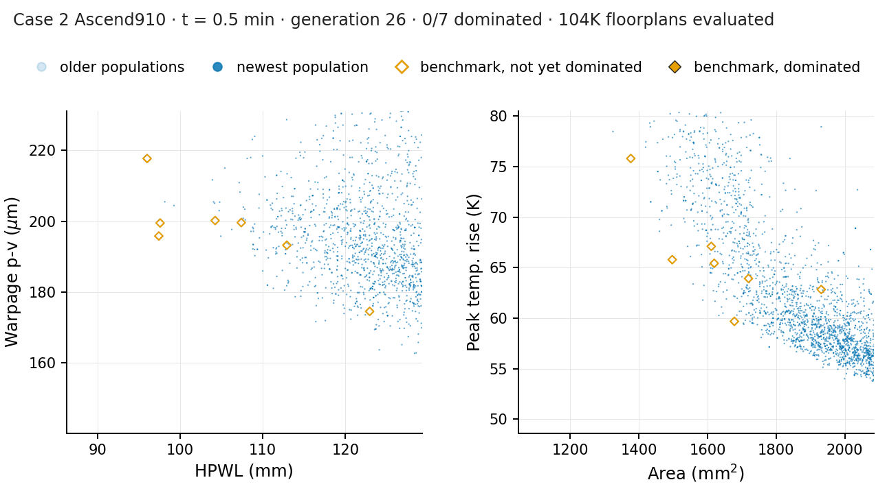</td>
</tr>
<tr>
<td></td>
<td>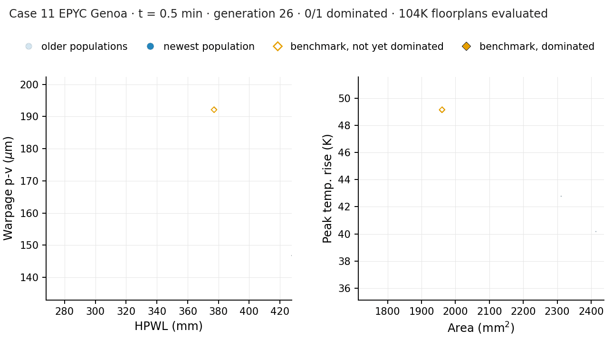</td>
</tr>
</table>

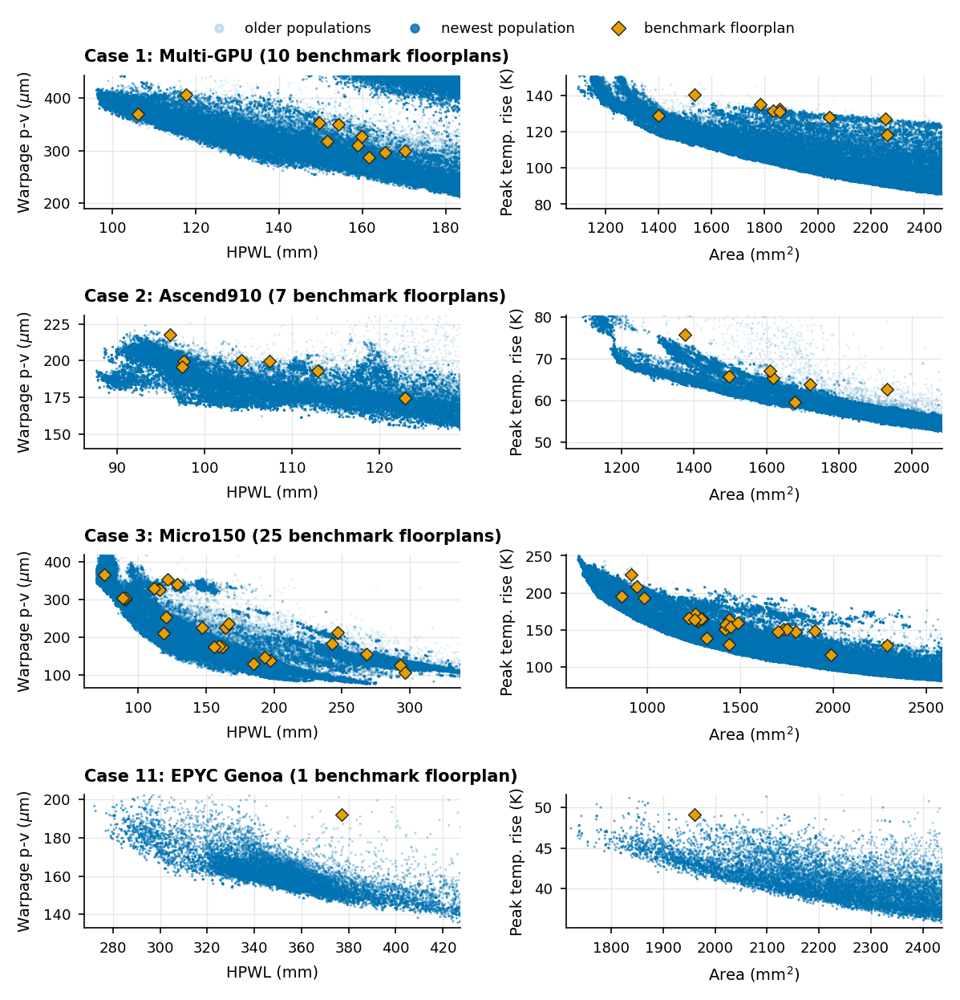

### Best floorplan of each objective over time

For each objective, the animation shows the best member of the population over time. For temperature and warpage the floorplan is drawn over the field.

<table>
<tr>
<td>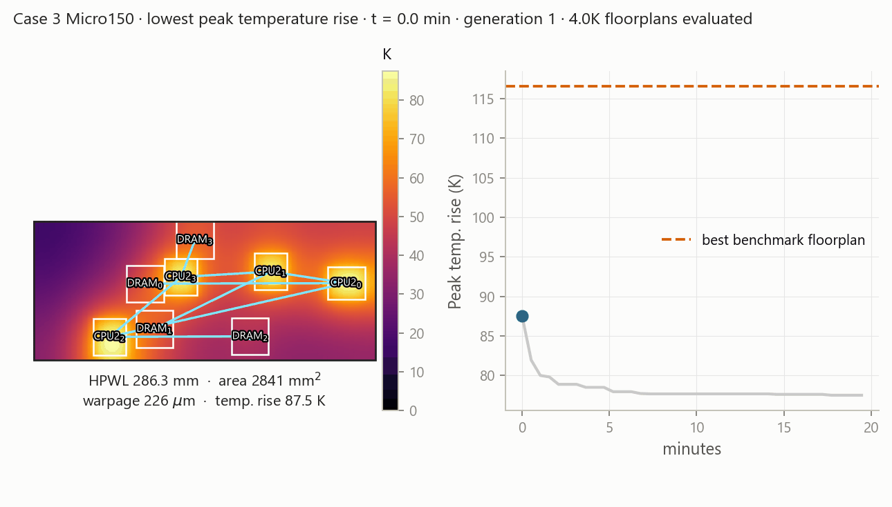</td>
<td>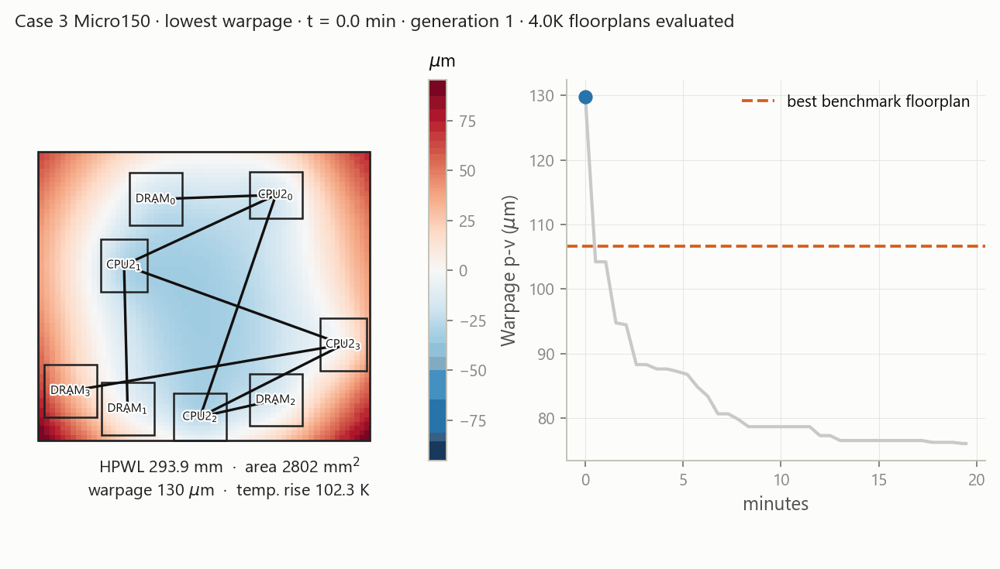</td>
</tr>
<tr>
<td>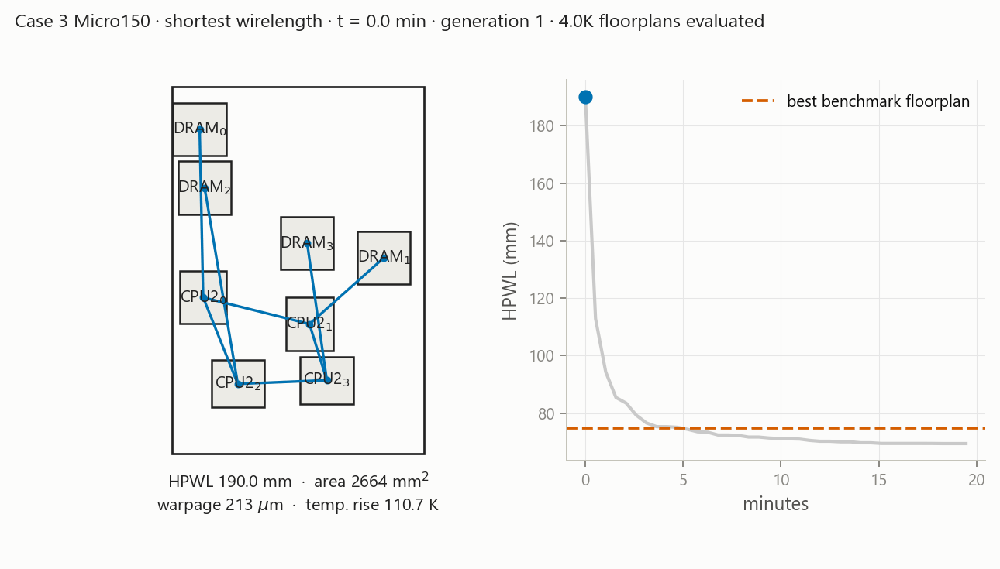</td>
<td>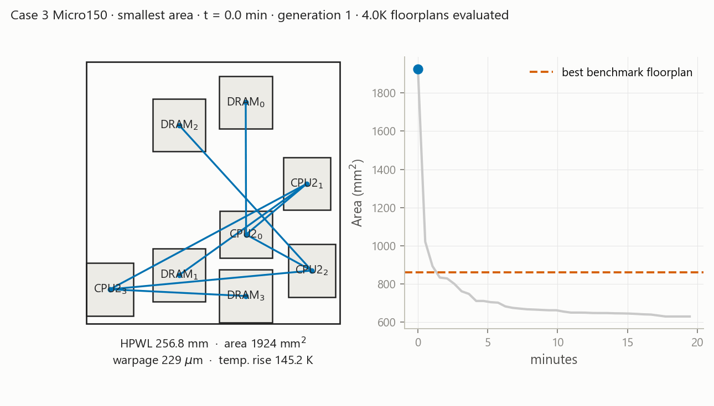</td>
</tr>
</table>

## Floorplan selection

For each reference floorplan, floorplans that dominate it are selected from the archive. The focused floorplan for an objective maximizes the improvement in that objective, and the balanced floorplan maximizes the sum of the improvements in all four objectives. To account for the error of the surrogate, a candidate must beat the reference in warpage and temperature with an additional margin.

## Verification in Ansys

All reference floorplans and all selected floorplans were evaluated again in Ansys Mechanical APDL, 208 solves in total. Each solve is a three-dimensional thermal analysis followed by a thermo-elastic analysis of the package, using the same stack, die powers, and metric definitions as the surrogate. The margin used in the selection was determined from a first set of Ansys evaluations, and the floorplans reported here were verified in a second set.

## Results

Improvement over the reference floorplans, evaluated in Ansys and averaged over the references. A minus sign denotes a reduction of the objective.

| | wirelength | area | warpage | peak temperature rise |
|---|---|---|---|---|
| Focused | -16.0 % | -7.4 % | -13.9 % | -12.8 % |
| Balanced | -14.0 % | -2.2 % | -9.3 % | -9.7 % |

In Ansys, the balanced floorplan dominates its reference in all four objectives for 40 of the 43 references.

| case | dominated | wirelength | area | warpage | peak temperature rise |
|---|---|---|---|---|---|
| 1 | 9 of 10 | -6.5 % | -1.9 % | -5.5 % | -11.9 % |
| 2 | 6 of 7 | -4.7 % | -2.5 % | -5.5 % | -4.3 % |
| 3 | 24 of 25 | -19.8 % | -2.2 % | -12.0 % | -10.4 % |
| 11 | 1 of 1 | -10.9 % | -3.6 % | -7.8 % | -7.5 % |

The next figure compares one reference floorplan per case with the balanced floorplan that dominates it, using the Ansys solutions.

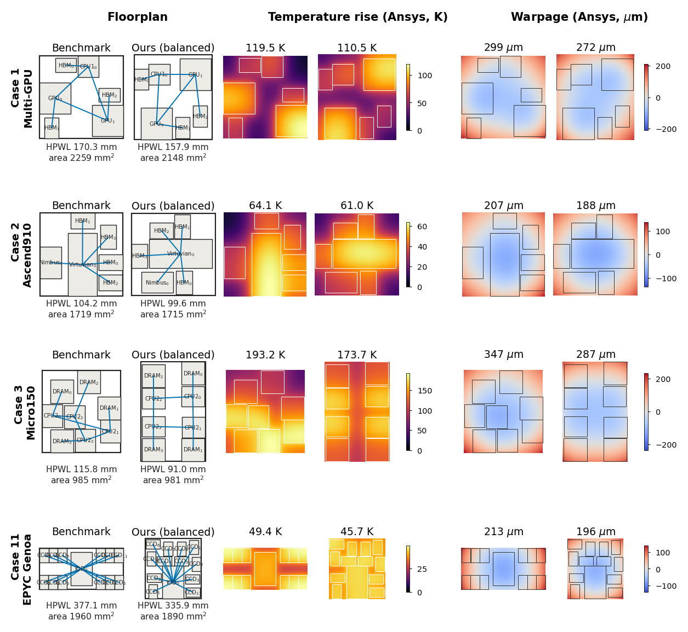

The shift from each reference floorplan to its balanced floorplan, for all 43 references:

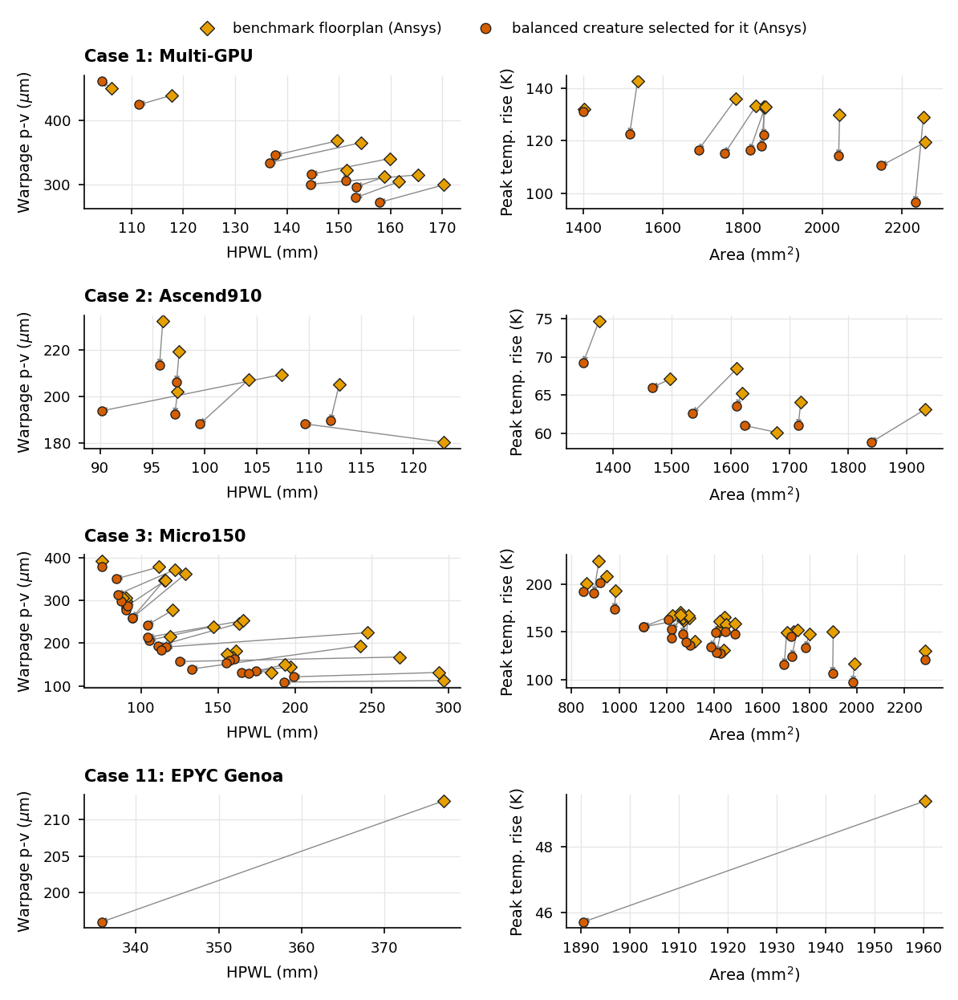

## Baseline Dataset Distribution

| Extracted Baseline Sample Paper Title | Abbreviation |
| :--- | :--- |
| `ATMPlace_Analytical_Thermo-Mechanical-Aware_Placement_Framework_for_2.5D-IC` | `ATMPLACE` |
| `ATPlace2.5D_Analytical_Thermal-Aware_Chiplet_Placement_Framework_for_Large-Scale_2.5D-IC` | `ATPLC25D` |
| `Connectivity-Guided_Feasibility_Masking_for_Efficient_Chiplet_Placement_in_2.5D_Packaging_via_Reinforcement_Learning` | `CGFMRL25` |
| `FAPlace_Joint_Optimization_of_Chiplet_Placement_and_Interposer_Footprint_for_2.5D_Systems` | `FAPLACE2` |
| `Chiplet_Placement_for_2.5D_IC_with_Sequence_Pair_Based_Tree_and_Thermal_Consideration`	| `CP25DSPT` |
| `Fast_Thermal-Aware_Chiplet_Placement_Assisted_by_Surrogate` | `FTACPSUR` |
| `RLplanner_Reinforcement_Learning_based_Floorplanning_for_Chiplets_with_Fast_Thermal_Analysis` | `RLPLANNR` |
| `STAMP-2.5D_Structural_and_Thermal_Aware_Methodology_for_Placement_in_2.5D_Integration` | `STAMP25D` |
| `TACPlace_Ultrafast_Thermal-Aware_Chiplet_Placement_with_Feasibility_Seeking` | `TACPLACE` |
| `TAP-2.5D_A_Thermally-Aware_Chiplet_Placement_Methodology_for_2.5D_Systems` | `TAP25DYS` |
| `TDPNavigator-Placer_Thermal-_and_Wirelength-Aware_Chiplet_Placement_in_2.5D_Systems_Through_Multi-Agent_Reinforcement_Learning` | `TDPNAVPL` |

### Dataset Analytics

| Method Representation | Case Representation | Method and Case Combination |
| :---: | :---: | :---: |
|  |  |  |
| 
Breakdown of placement methods represented across the 42 baseline benchmark samples:    • **TAP25DYS**: 17 samples (40.5%)  • **ATPLC25D**: 4 samples (9.5%)  • **CP25DSPT / FTACPSUR / RLPLANNR / STAMP25D**: 3 samples each (7.1% each)  • **ATMPLACE / CGFMRL25 / TACPLACE / TDPNAVPL**: 2 samples each (4.8% each)  • **FAPLACE2**: 1 sample (2.4%)
 | 
Distribution of benchmark test cases across the dataset:    • **Case 3 (Micro150)**: 25 samples (59.5%)  • **Case 1 (Multi-GPU)**: 10 samples (23.8%)  • **Case 2 (Huawei Ascend 910)**: 7 samples (16.7%)
 | 
Grouped breakdown showing baseline representation of each case across each method **Case 1**, **Case 2**, and **Case 3**.
 |

### Benchmark Case Topologies

| Case 1 - Multi-GPU | Case 2 - Huawei Ascend 910 | Case 3 - Micro150 |
| :---: | :---: | :---: |
|  |  |  |
| **Architecture**: 6-chiplet topology featuring 1 CPU (`CPU1_0`, $12 \times 12\text{ mm}$, $105\text{ W}$), 2 GPUs (`GPU_0` & `GPU_1`, $18 \times 18\text{ mm}$, $300\text{ W}$ each), and 3 HBM stacks (`HBM_0`–`HBM_2`, $8 \times 12\text{ mm}$, $25\text{ W}$ each). | **Architecture**: 6-chiplet topology centered around a central compute die (`Virtuvian_0`, $31.4 \times 14.5\text{ mm}$, $256\text{ W}$) connected to 1 I/O die (`Nimbus_0`, $10.5 \times 16\text{ mm}$, $14\text{ W}$) and 4 HBM stacks (`HBM_0`–`HBM_3`, $8 \times 12\text{ mm}$, $25\text{ W}$ each). | **Architecture**: (a.k.a CPU-DRAM) 8-chiplet mesh topology consisting of a $2 \times 2$ CPU array (`CPU2_0`–`CPU2_3`, $8 \times 9\text{ mm}$, $150\text{ W}$ each) paired with 4 DRAM chiplets (`DRAM_0`–`DRAM_3`, $9 \times 9\text{ mm}$, $20\text{ W}$ each). |

### Manual Benchmark Extraction & Digitization Methodology

Because raw placement coordinates are rarely distributed alongside published 2.5D IC placement results, all 42 baseline floorplans were manually extracted and digitized by hand from the floorplan and thermal-map figures in their respective publications.

#### Digitization Workflow
1. **Figure Cropping & Interposer Calibration**: Each published floorplan image was cropped tightly to the interposer boundary setting the bottom-left corner as the `(0, 0)` origin, and mapped to its reported physical interposer dimensions ($W \times H$ in mm, such as $39.0 \times 39.0\text{ mm}$, $45.0 \times 45.0\text{ mm}$, or $50.0 \times 50.0\text{ mm}$) to compute exact pixel-to-millimeter conversion ratios (`px/mm`).
2. **Chiplet Bounding Box Annotation**: Using each chiplet's known physical footprint (`dim` in mm) from the benchmark specification (`Case1`, `Case2`, `Case3`), the bottom-left `(x_min, y_min)` and top-right `(x_max, y_max)` coordinates of every die were manually aligned and recorded over the source figure.
3. **Adjacency & Orientation Verification**: Chiplet identities, rotations, topology, and connectivity were cross-checked against each benchmark's adjacency graph to ensure accurate die labeling.
4. **Visual Overlay Validation**: Every digitized placement was rendered on top of its grayscaled original source figure with dashed bounding boxes, corner coordinate callouts, and interconnect lines to verify sub-millimeter visual alignment across all three benchmark cases.

### Extraction Validation Overlays

#### Case 1 Overlays (Multi-GPU - 10 floorplans)
  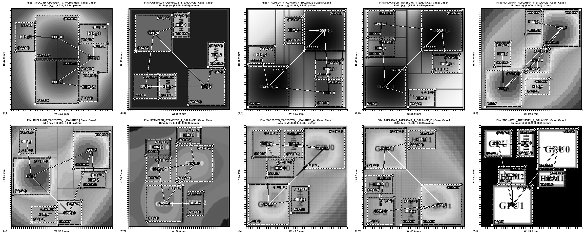
#### Case 2 Overlays (Huawei Ascend 910 - 7 floorplans):
  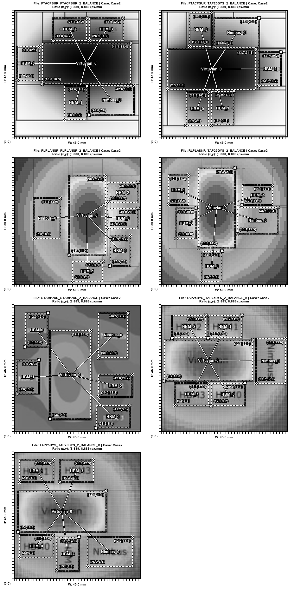
#### Case 3 Overlays (Micro150 - 25 floorplans)
  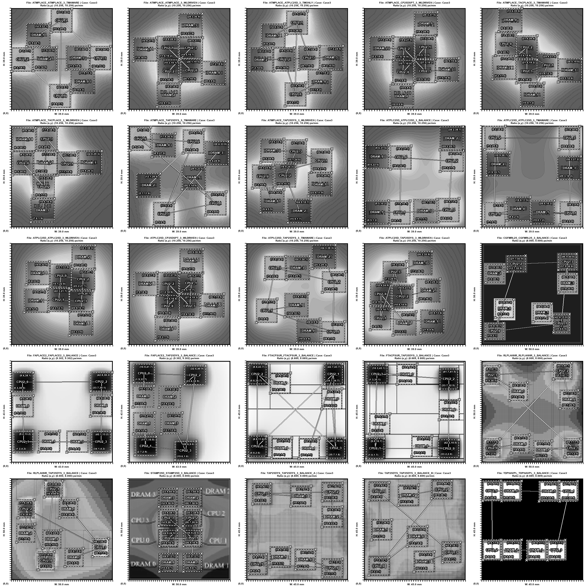
#### Case 11 Floorplan
  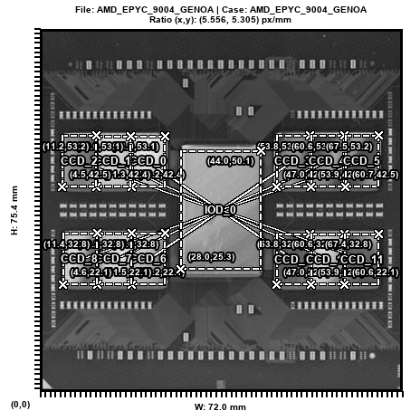
